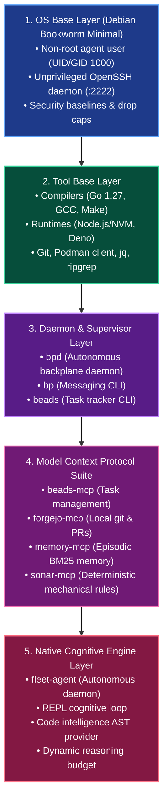
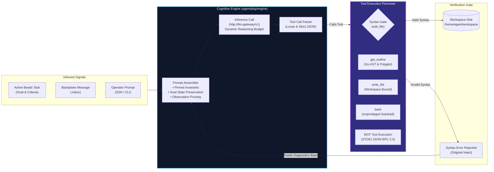
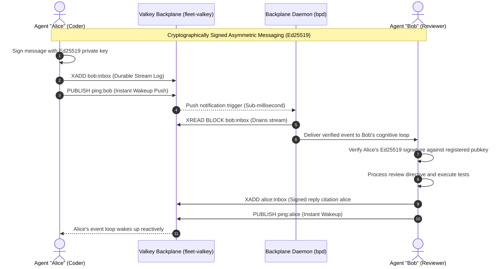
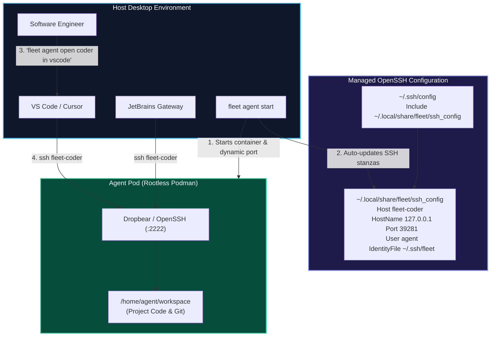

<!--
Copyright (c) 2026 Boggy Creek Software LLC

Use of this source code is governed by an MIT-style
license that can be found in the LICENSE file.
-->

# Fleet Platform — Visual Architecture & Capabilities Infographic

Welcome to the **Fleet Architecture Visual Walkthrough**. This guide uses structured visual diagrams, flowcharts, sequence illustrations, and architectural slides to explain how Fleet enables autonomous AI coding agents to operate safely and effectively on physical developer machines.

---

## 1. The Big Picture: Hard Security Perimeters

> [!IMPORTANT]
> **The Core Philosophy**: Fleet eliminates per-command human approval prompts without sacrificing host security. Agents operate with full autonomy inside isolated Podman containers while guaranteeing **zero leakage of host secrets**.

```mermaid
flowchart TB
    subgraph Host["Physical Host Machine (Linux / macOS)"]
        direction TB
        Operator["Human Developer / Operator"]
        HostCLI["Fleet CLI (fleet / ft)"]
        HostSSH["~/.ssh/config (Managed Include)"]
        HostDolt["Platform Dolt Backlog (sndbx-*)"]
        LocalLLM["Local Inference Gateway (Ollama / vLLM / llama.cpp)\n127.0.0.1:11434 / 8000"]

        Operator -->|Administers| HostCLI
        Operator -->|Opens in IDE| HostSSH
        HostCLI -->|Tracks Issues| HostDolt
    end

    subgraph PodmanSandbox["Rootless Podman Container Sandbox"]
        direction TB
        
        subgraph AgentPod["Agent Container (fleet-<name>)"]
            AgentDaemon["fleet-agent (Daemon PID 1)"]
            REPLEngine["Cognitive REPL Engine"]
            Tools["Builtin Tools (bash, edit_file, get_outline)"]
            MCPServers["MCP Servers (beads, forgejo, memory, sonar)"]
            InContainerSSH["OpenSSH Daemon (:2222)"]
            
            AgentDaemon --> REPLEngine
            REPLEngine --> Tools
            REPLEngine --> MCPServers
        end

        subgraph SharedInfra["Shared Local Infrastructure (fleet-infra bridge)"]
            Valkey["Valkey 8 Backplane (fleet-valkey:6379)\nStreams & Pub/Sub"]
            Forgejo["Forgejo 9 Local Forge (fleet-forgejo:3000)\nTasks & Shared Tools"]
        end
    end

    HostCLI -->|Orchestrates| AgentPod
    HostCLI -->|Manages| SharedInfra
    HostSSH -->|Direct SSH (Port 2222)| InContainerSSH
    REPLEngine -->|Queries LLM via llm-gateway| LocalLLM
    AgentDaemon -->|Encrypted Messaging| Valkey
    MCPServers -->|Task & Code Sync| Forgejo

    classDef host fill:#1e293b,stroke:#3b82f6,stroke-width:2px,color:#f8fafc;
    classDef container fill:#0f172a,stroke:#10b981,stroke-width:2px,color:#f8fafc;
    classDef infra fill:#1e1b4b,stroke:#8b5cf6,stroke-width:2px,color:#f8fafc;
    class Host host;
    class AgentPod container;
    class SharedInfra infra;
```

---

## 2. Layered OCI Container Hierarchy

Fleet packages its containerized runtime as an immutable, composable OCI hierarchy built on rootless Podman (ADR 00006 & ADR 00043):



---

## 3. Cognitive Agent Architecture: Inside `fleet-agent`

Inside each running agent container, the autonomous harness coordinates cognitive reasoning, safe file mutations, and multi-tier memory:



---

## 4. Cross-Agent Backplane Messaging Fabric

Agents collaborate asynchronously via the high-speed Valkey Streams & Pub/Sub backplane bus (`bp` / `libbp`):



---

## 5. Zero-Touch Desktop IDE Remote Development

Developers attach their desktop editors directly to isolated agent sandboxes without configuring ports or installing server software manually:



---

## 6. Two-Plane Task Tracking: Complete Host Isolation

Fleet enforces strict physical separation between platform development and autonomous in-container execution:

| Dimension | Host Platform Plane (Contributors) | In-Container Agent Plane (Autonomous Agents) |
| :--- | :--- | :--- |
| **Tracking Engine** | **Dolt SQL Database** (`bd`) | **Forgejo Git Repository** (`fleet/tasks.git`) |
| **Issue Identifier** | `sndbx-*` (e.g. `sndbx-sd3`) | `task-*` (e.g. `task-104`) |
| **Remote Sync** | GitHub `refs/dolt/data` | Local Forgejo `http://forgejo:3000/fleet/tasks.git` |
| **Credential Boundary** | Host SSH keys & developer GitHub tokens | Ephemeral in-container Forgejo tokens (zero host secrets) |
| **Purpose** | Fleet platform codebase development | Application coding inside user workspace |

---

## 7. Command Quick-Reference Cheat Sheet

```bash
# === Agent Lifecycle ===
fleet agent create coder as go-dev          # Create new agent instance
fleet agent start coder                     # Start container & allocate SSH port
fleet agent open coder in vscode            # Attach desktop VS Code via Remote-SSH
fleet agent tmux coder                      # Attach interactively to supervisor
fleet agent stop coder                      # Halt agent container
fleet agent clean coder                     # Remove container (preserve home volume)
fleet agent retire coder --force            # Complete deprovisioning (purge all state)

# === Diagnostics & Self-Healing ===
fleet agent doctor coder                    # Audit agent health & auto-heal defects
fleet infra doctor                          # Audit Valkey, Forgejo, & bridge networks

# === Cross-Agent Backplane Messaging ===
bp whoami                                   # Inspect resolved cryptographic identity
bp say "Starting task sndbx-42"             # Broadcast public feed message
bp tell reviewer "PR #12 is ready for review" # Direct point-to-point inbox message
bp recv --wait                              # Reactive inbox push drain
bp peers                                    # List registered agents & live status
```
